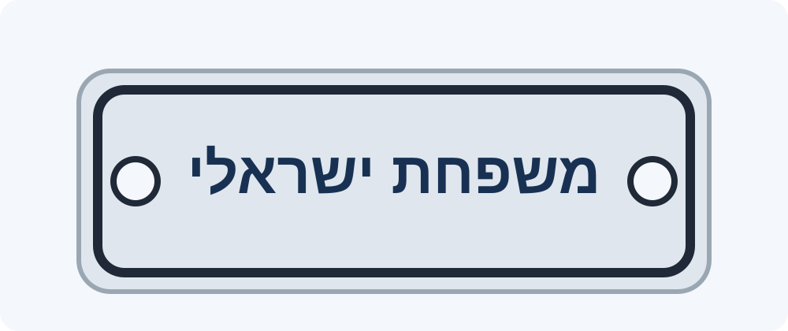
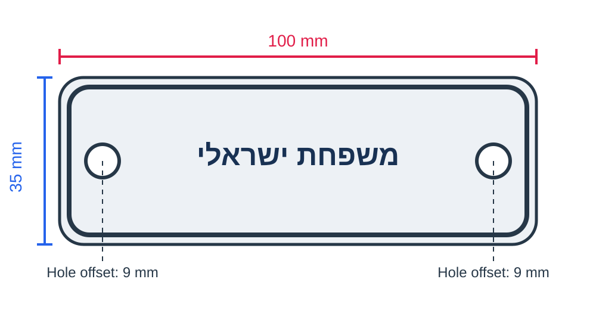
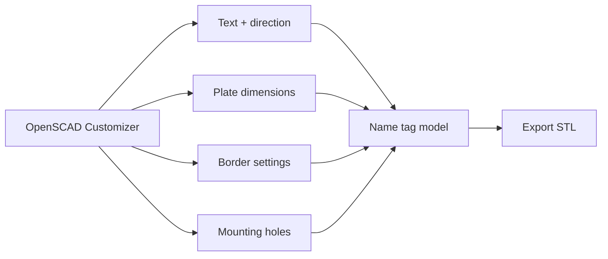

# Customizable Mailbox Name Tag

A customizable OpenSCAD mailbox nameplate for **משפחת ישראלי**, with embossed text, a decorative border, and optional countersunk mounting holes. It includes automatic Hebrew/RTL text support.

## Preview

## Dimensions

The default plate is 100 × 35 mm. Mounting holes are optional and, when enabled, are placed symmetrically 9 mm from the left and right edges.

## Features

- One or two embossed text lines
- Hebrew and RTL text support
- Automatic text fitting
- Optional decorative border
- Optional screw holes with countersinks
- Separate plate and text export for multi-color printing
- Sharp or rounded corners

## OpenSCAD Customizer

1. Install [OpenSCAD](https://openscad.org/).
2. Open `mailbox_name_tag.scad`.
3. Open **Window → Customizer**.
4. Adjust parameters in the Text, Plate, Border, Mounting, and Render sections.
5. Press **F6** to render, then **F7** to export an STL.

## Main Parameters

| Parameter | Default | Description |
|---|---:|---|
| `line1` | `משפחת ישראלי` | Primary text |
| `line2` | `""` | Optional secondary text |
| `font_name` | Liberation Sans Bold | Installed OpenSCAD font |
| `plate_width` | `100` mm | Plate width |
| `plate_height` | `35` mm | Plate height |
| `plate_thickness` | `2.5` mm | Plate thickness |
| `corner_radius` | `5` mm | Corner rounding |
| `add_border` | `true` | Enable the border |
| `add_holes` | `false` | Enable mounting holes |
| `hole_diameter` | `3.5` mm | Screw shaft diameter |
| `countersink_diameter` | `7` mm | Screw head diameter |
| `hole_edge_offset` | `9` mm | Hole inset from each side |
| `part` | `all` | Output `all`, `plate`, or `text` |

## Printing

For a two-color print:

- Set `part = "plate"` and export the base.
- Set `part = "text"` and export the embossed text.
- Use `part = "all"` for a normal single-color print.

## Hebrew Text

Hebrew is detected automatically with `text_direction = "auto"`. Supported values are:

- `"auto"` — detect direction from text
- `"ltr"` — left-to-right
- `"rtl"` — right-to-left

## Exported Parts

## License

This project is licensed under the **GNU General Public License v3.0**. See [GNU GPL v3](https://www.gnu.org/licenses/gpl-3.0.html) for the full license terms.
